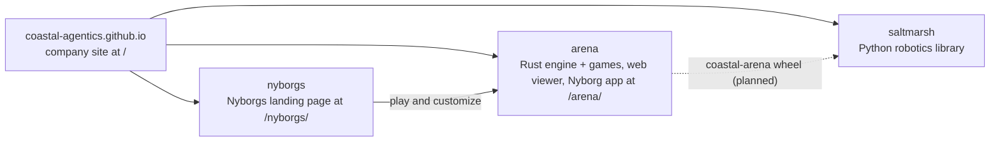

# Nyborgs, a Coastal Agentics project

The landing page for **Nyborgs**: Nye Warburton's customizable agents, with round cream heads, dot eyes and fuzzy hair (a shaggy mop, a pom cloud, a Muppet fringe, a tousled crest or classic yarn). Every Nyborg gets the same nine-point budget, and cosmetics never affect stats. One Nyborg can train in any arena: tank and racing today, more later.

Served by GitHub Pages at <https://coastal-agentics.github.io/nyborgs/> from the root of `main`. Its front door is the **Nyborg app** in [Coastal-Agentics/arena](https://github.com/Coastal-Agentics/arena):

- Make your Nyborg / Your Nyborgs: [/arena/play/](https://coastal-agentics.github.io/arena/play/)
- Race: [/arena/play/#/play/racing](https://coastal-agentics.github.io/arena/play/#/play/racing)
- Tank: [/arena/play/#/play/tank](https://coastal-agentics.github.io/arena/play/#/play/tank)
- Arena overview: [/arena/](https://coastal-agentics.github.io/arena/), field notes: [/arena/fieldnotes.html](https://coastal-agentics.github.io/arena/fieldnotes.html)

If this browser has Nyborgs saved by the app (same origin, `arena.nyborg.*` in localStorage), the page greets the selected one by name. The script is read-only and uses `textContent` only.

Company site: <https://coastal-agentics.github.io/> ([Coastal-Agentics/coastal-agentics.github.io](https://github.com/Coastal-Agentics/coastal-agentics.github.io)). Coastal Agentics: behavioral design for agents, from Savannah, Georgia.

## How the repos fit

Coastal Agentics has four public repos. They all live in the [Coastal-Agentics](https://github.com/Coastal-Agentics) GitHub org, and their sites are served together under one host.

| Repo | What it is | Owner |
| --- | --- | --- |
| [coastal-agentics.github.io](https://github.com/Coastal-Agentics/coastal-agentics.github.io) | The company site, served at `/` ([site](https://coastal-agentics.github.io/)) | Soundwave (legal pages: Onslaught) |
| [nyborgs](https://github.com/Coastal-Agentics/nyborgs) | The Nyborgs landing page, served at `/nyborgs/` ([site](https://coastal-agentics.github.io/nyborgs/)) | Blitzwing |
| [arena](https://github.com/Coastal-Agentics/arena) | The Rust engine (`engine`, `engine-cli`, `engine-wasm`, and `engine-py`, the `coastal-arena` Python wheel) plus the Tank Arena and racing games, the web viewer and the Nyborg app, served at `/arena/` ([site](https://coastal-agentics.github.io/arena/)) | Engine: Shockwave. Games, web viewer and Nyborg app: Blitzwing |
| [saltmarsh](https://github.com/Coastal-Agentics/saltmarsh) | The Python robotics library: MuJoCo simulation, datasets, behavior and evaluation, and the robot arm demo | Shockwave |

"Saltmarsh" means only the Python robotics library. The engine is the Arena engine, and it lives in `arena`.

## What's here

| File | Purpose |
| --- | --- |
| `index.html` | The page: shared Coastal Agentics header and footer, **Make your Nyborg**, what a Nyborg is, and Race / Tank / Your Nyborgs cards into the app. Inline CSS and a tiny welcome-back script, no build step |
| `nyborgs.png` | Header art: three Nyborgs drawn by the app's own renderer (`tools/render-art.py <arena>/web`), so the splash shows the same hair as the app |
| `logo.svg`, `logo-wordmark.svg`, `favicon.svg` | Coastal Agentics mark, wordmark and favicon, copied from the company site |
| `flock.js` | The company site's quiet background flock |
| `tools/shoot.py` | Screenshots the page and checks every link plus the welcome-back greeting in headless Chromium, against a local arena build (`tools/shoot.py <arena>/web`) or the live site (`--live`) |
| `.nojekyll` | Tells Pages to serve the files as-is |

## Links

Links between the three sites are root-relative (`/`, `/nyborgs/`, `/arena/`), so they keep working when the company site moves to its own domain. Local preview of the whole set: put the company site at the root of a folder, this repo at `nyborgs/` and arena's `web/` at `arena/`, then run `python3 -m http.server` in that folder.
